# 3 Ons Dashboard: are an accounting firm's audit and tax jobs on time, on budget and on point?

An accounting and advisory firm in Malaysia uses it to decide which audit and tax jobs to chase before they miss their deadline, which finished jobs did not pay for the time spent on them, and how much fee lost to resigning clients still has to be won back. It replaced a Power BI report that needed a Power BI licence for everyone who opened it.
In use since June 2026 by the heads of Audit and Tax and their team managers.

**3 Ons** is the firm's name for three questions asked of every job. **On Time**: did the audit draft go out within 45 days of the client's management accounts coming in, and the tax draft within 60? **On Budget**: did the fee cover the cost of the staff time booked to the job? **On Point**: did a reviewed job go through the firm's quality-review form? A fourth part tracks the clients who leave.

<!-- video: drag docs/video/3ons-dashboard.webm into this spot in the github.com editor to get an inline player -->
🎬 **[Watch the 1-minute explainer](docs/video/3ons-dashboard.webm)** (voice and captions): what changed from the Power BI report, where the data comes from, and what one press of Refresh does (made-up data)

> **About the data:** every number, company and person on this page and in the demo is made up. The real dashboard runs on the firm's own data and is private.

| | |
|---|---|
| 🖱️ **[Try the demo](https://trisglenanne9.github.io/3ons-dashboard/)** | the real dashboard with made-up data, in your browser, no login |
| 📘 **[User guide](docs/GUIDE.md)** | every tab, chart, filter and definition |
| 🛠️ **[Technical architecture](docs/ARCHITECTURE.md)** | the same design in developer detail |

## Before and now

| | Before: one Power BI report | Now: the 3 Ons dashboard |
|---|---|---|
| **Who can open it** | a Power BI licence for each viewer | anyone with a company sign-in, in any browser |
| **How fresh** | as at the file's last refresh | Refresh rebuilds every figure from today's files in about a minute; a frozen copy is saved every Saturday |
| **The rules** | hidden in Power Query steps, page filters, saved slicers and measures | written once in code, and matched to the old report before go-live |
| **If a source breaks** | the old figures stay up, with no sign on the page | a warning names the file that failed or moved; the last good figures stay up |
| **Where the data sits** | inside a 30 MB report file | the firm's own Azure: private storage, read links that expire after 15 minutes |

## The problem

The figures live in about thirty workbooks and exports kept by different teams: three yearly tax control workbooks, six audit team job logs, the resignation registers, two quality-review trackers, and the practice-management system's job and timesheet exports. A Power BI report pulled them together, but everyone who opened it needed a Power BI licence, it showed whatever its last refresh had pulled in, and its rules were hidden in page filters, saved slicer selections and measures that nobody could see from the page.

The brief was simple: **match the Power BI numbers first, then improve**, and type nothing in by hand. Every figure is worked out again from the teams' own files each time the data is refreshed.

## What it shows

- **Job Tracker:** how many audit and tax jobs have their management accounts in this year, what share is on time, and whether reviewed work went through On Point?
- **TBA Tracker:** of the audit jobs completed and the tax returns submitted, how many covered the cost of their time?
- **Audit 45D:** which audit jobs are past 45 days, and in which job status, client category and team?
- **Tax 60D:** which tax jobs are past 60 days, what do they bill, and which team holds them?
- **Audit TBA:** which completed audit jobs missed the budget test, by team and client category, and which companies are they?
- **Tax TBA:** which submitted tax returns missed the budget test, and what does the team's weekly comment on each one say (in the export)?
- **Tax On Point:** how many tax jobs past review have their quality-review form, and how many don't?
- **Resignation Tracker:** which audit, tax and accounting clients left in the week that just closed?
- **Resignation Tracker YTD:** who has left this year, and how much fee is still to be covered once work referred in by staff is counted?

## Where the data comes from

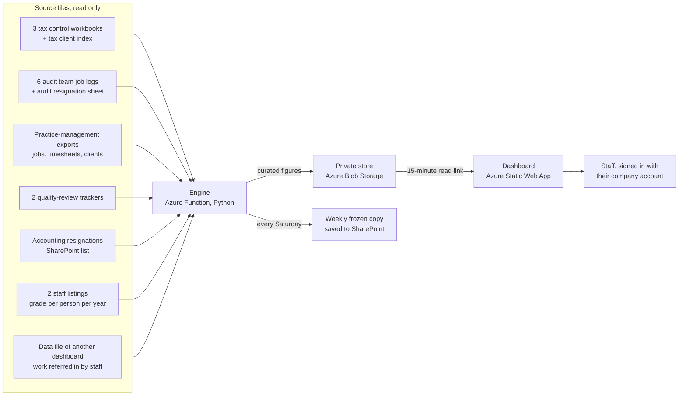

| Source | What it holds | How it's read | How often |
|---|---|---|---|
| Three yearly tax control workbooks | every tax client per year: status, team, client category, when the management accounts came in, days to draft, the weekly comment; plus the tax quality-review submissions | from SharePoint, never changed | updated by the tax team as jobs move; read on every refresh |
| Six audit team job logs | every audit job: status, stage, days from management accounts to draft, audit fee, client category | from SharePoint, never changed | updated by each audit team; read on every refresh |
| Resignation registers | audit and tax clients who resigned, with date, reason, fee, team and category | from SharePoint, never changed | read on every refresh |
| Accounting resignations | clients leaving accounting services, which services, approval status | a SharePoint list, read only | read on every refresh |
| The practice-management system's exports | every job and what it invoiced, every timesheet line, every client's tax team and category | CSV files the system drops into SharePoint | exported automatically; read on every refresh |
| Quality-review tracker (audit) | which audit jobs have an On Point submission | from SharePoint, never changed | read on every refresh |
| Two staff listings | each person's grade, year by year, which sets their cost rate | from OneDrive, never changed | read on every refresh; a saved copy is used if they can't be reached |
| Another dashboard's data file | the value of new work referred in by staff this year | from that dashboard's private store | as fresh as that dashboard's own refresh |

29 sources in all. Nothing is copied in by hand, and the only figures built into the engine are the cost rate per grade per year, taken from the old Power BI file.

## What one press of Refresh does

1. **Read.** Each file is fetched by its ID, and only the files IT granted can be reached. A file that was moved or renamed is still found, and the route used is logged.
2. **Clean.** The old report's Power Query steps, ported one for one: about 20 status codes roll up into 4 status groups, and money like `1,234.56` or hours like `1:30` are read as numbers instead of being lost as text.
3. **Combine.** Each job gets its invoice and its timesheet lines; the cost of a job is the hours booked × each person's grade rate for that year. Resignations are joined to each client's team and category.
4. **Score the 3 Ons.** *On time*: draft within 45 days of the management accounts (audit) or 60 (tax). *On budget*: the fee covers the cost of the time, with a margin of at least 67%. *On point*: a quality-review submission exists.
5. **Publish.** Six small files go to private storage, stamped with the build time. A run that fails changes nothing: the last good figures stay up, and the page says what went wrong.

It takes about a minute, and then everyone sees the same new figures.

## How it stays right

- **Matched the old report first.** The old report's own stored data was run through the new engine: the status of every tax and audit job came out 100% the same, and the tax on-time bands 100% the same. The audit on-time bands matched 91.99%, and every difference is a job sitting one day either side of a band boundary because the source workbook's own day count has moved on since Power BI froze it. The Audit On Time percentage counts the days directly, so it is not affected.
- **Matched the other dashboard.** The referred-work figures agree exactly with the dashboard they come from.
- **Nothing hard-coded.** Every figure is recomputed from the source files on each refresh, with the same rules as the old report, written down in one place.
- **Says when it isn't right.** The page shows when the figures were last rebuilt, in Malaysia time. A warning appears if a source failed to load, if a file was only found by searching (someone moved it), if cost rates came from the saved copy, or if the figures are three or more days old.
- **Fails loudly, never quietly.** If a workbook's column names change, the refresh stops instead of publishing an empty table. If a refresh fails, the previous figures stay on screen.

## Screens

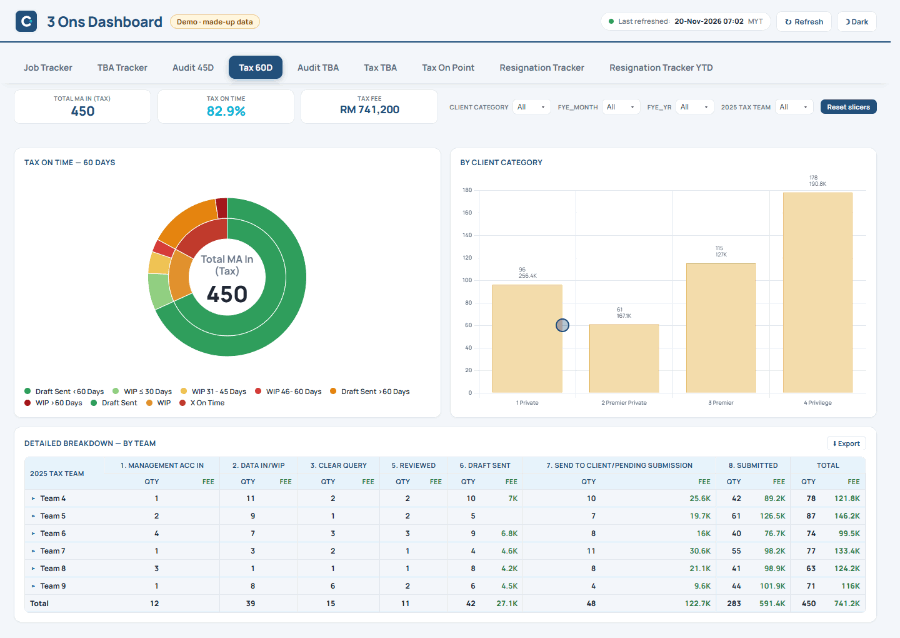

### See where we stand

<table>
<tr>
<td colspan="2"><b>Job Tracker</b>: audit and tax side by side: jobs in this year, the share on time, and whether reviewed work went through On Point 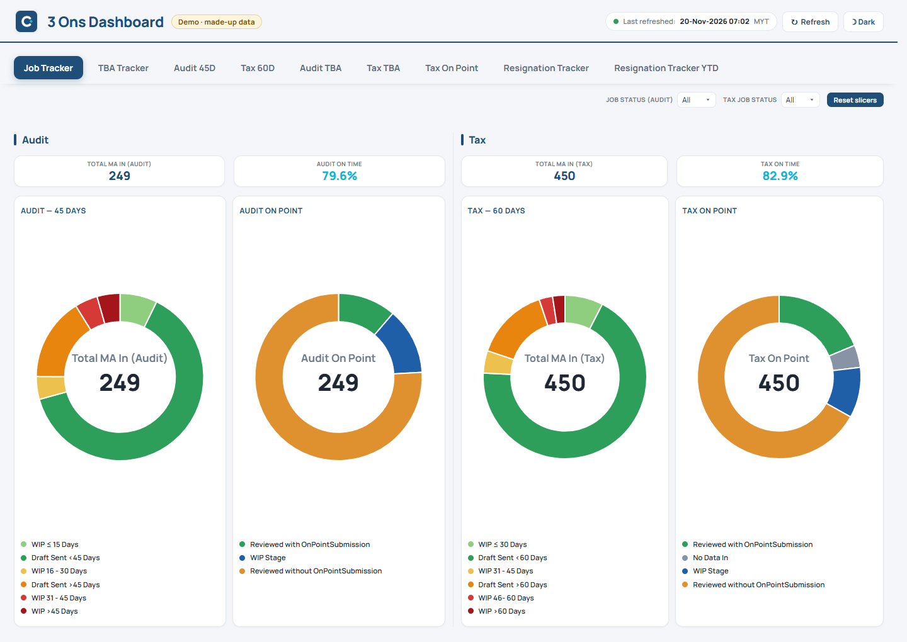</td>
</tr>
<tr>
<td width="50%"><b>Audit 45D</b>: how late, by job status, client category and team 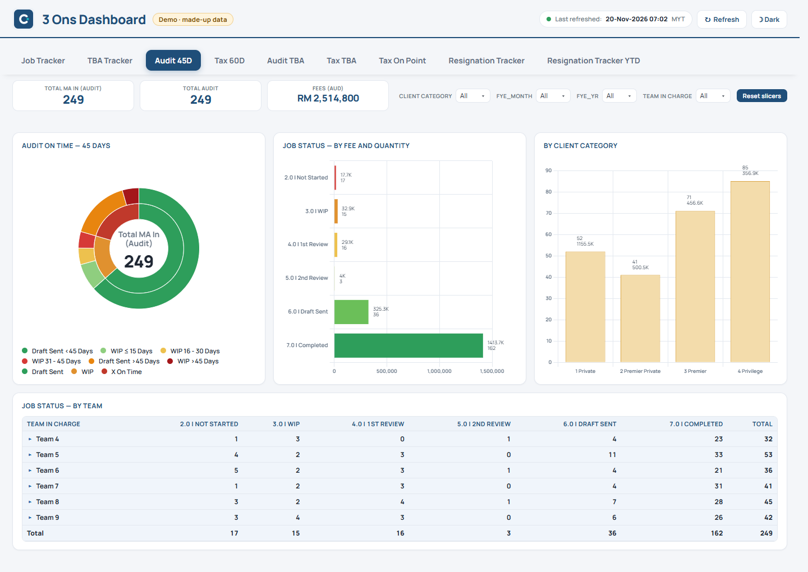</td>
<td width="50%"><b>Tax 60D</b>: the 60-day ring, fees by client category, and every team's jobs by status 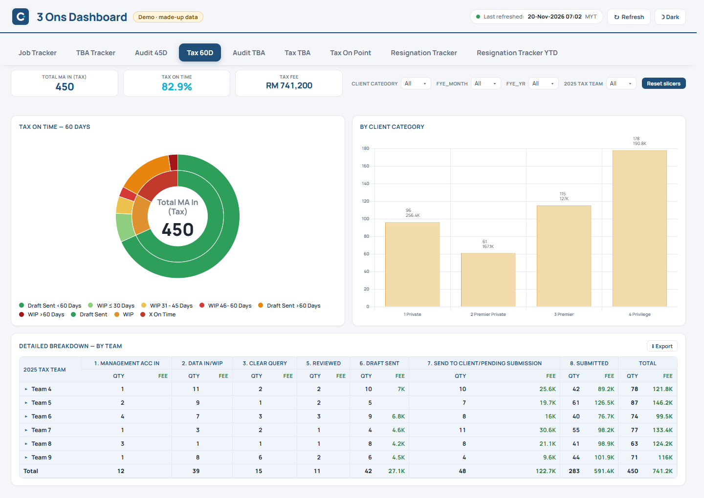</td>
</tr>
<tr>
<td width="50%"><b>TBA Tracker</b>: finished audit and tax jobs that did, or did not, cover the cost of their time 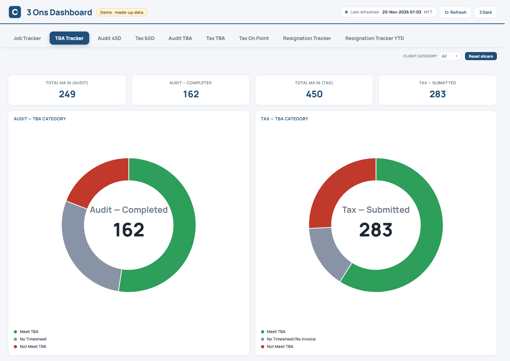</td>
<td width="50%"><b>Audit TBA</b>: the jobs that missed, by team and client category, and the list behind them 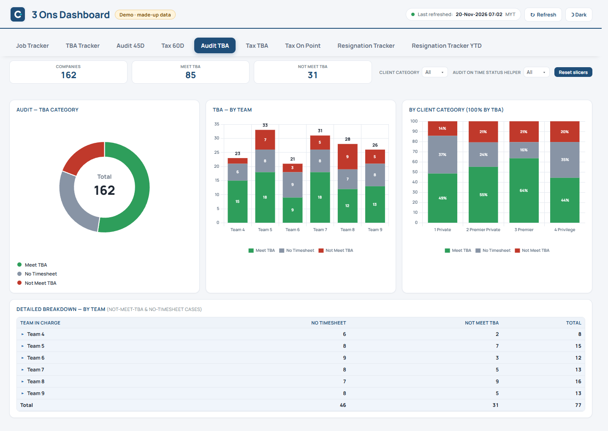</td>
</tr>
</table>

### Find the cause

<table>
<tr>
<td width="50%"><b>Filter by client category</b>: "Private + Premier Private" picked with one tick, and every figure follows 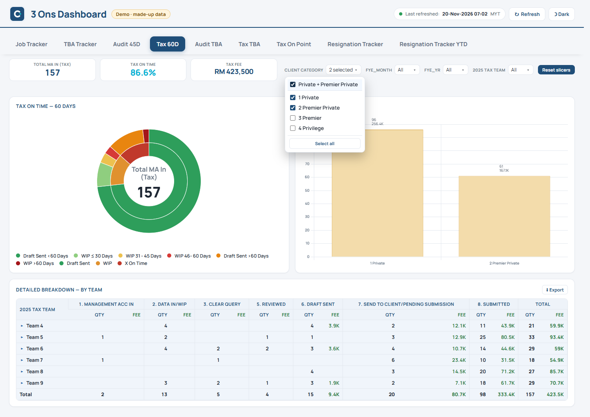</td>
<td width="50%"><b>Click a chart to filter everything</b>: one click on a ring slice and every visual follows; a "Cross-filter" chip says what is applied, and its ✕ clears it 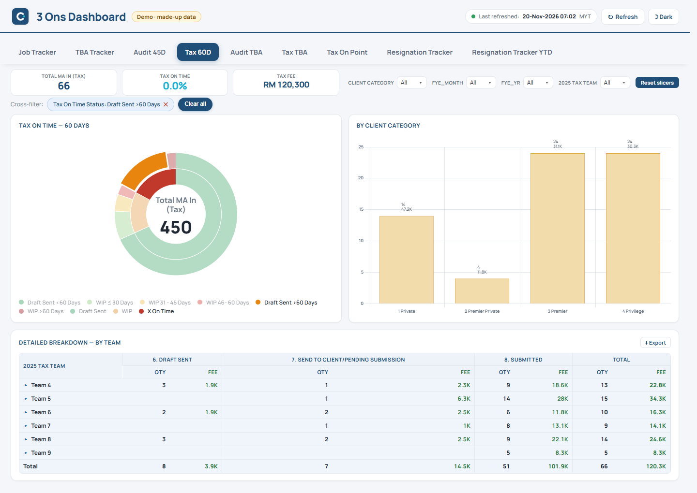</td>
</tr>
<tr>
<td colspan="2"><b>Drill down to the company</b>: open a team to see which clients are late and what they bill, status by status 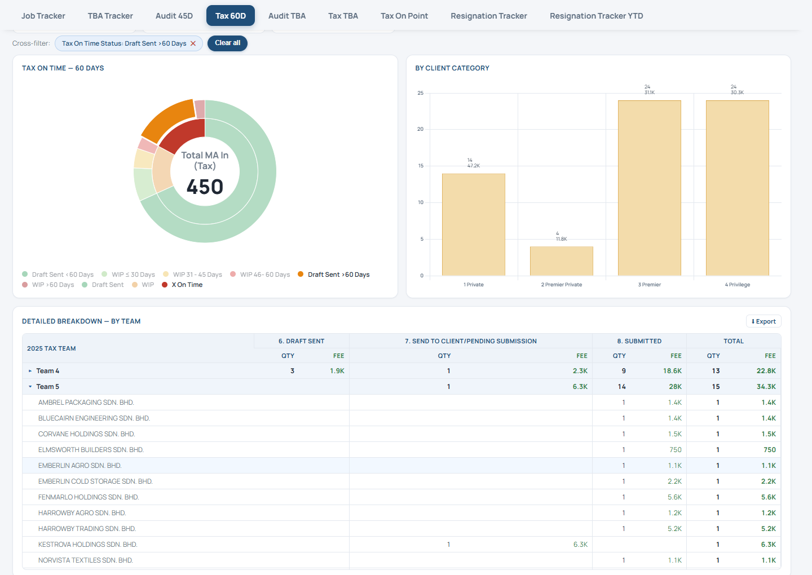</td>
</tr>
</table>

### Track who is leaving

<table>
<tr>
<td width="50%"><b>This week</b>: audit, tax and accounting resignations for the latest closed Friday-to-Thursday week 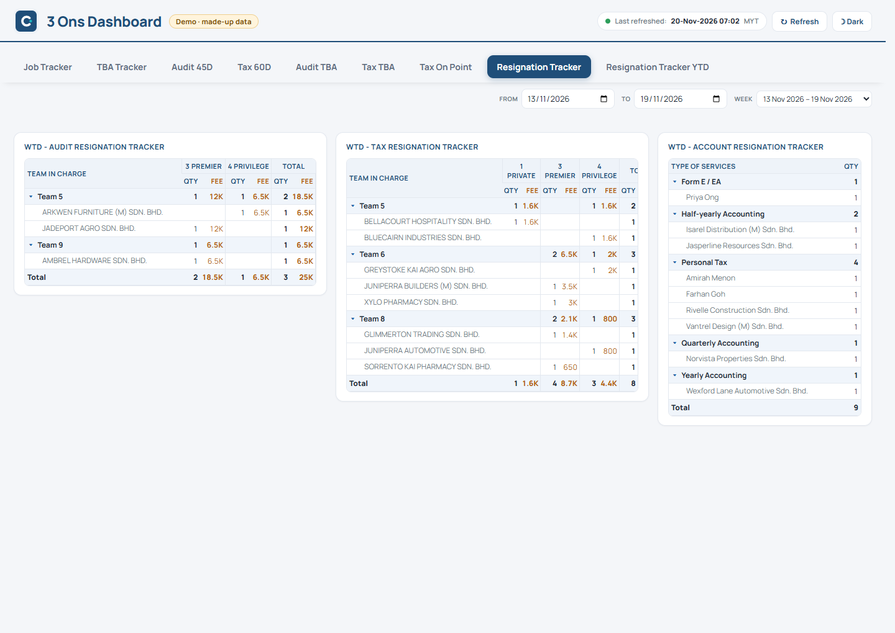</td>
<td width="50%"><b>This year, and the fees to cover</b>: fees lost to resignations, less fees referred in by staff 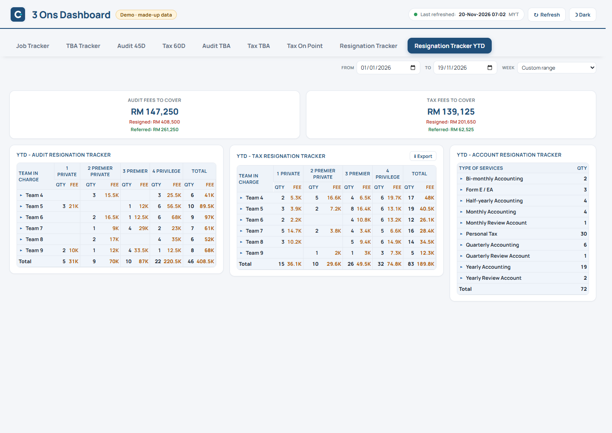</td>
</tr>
</table>

### Light, dark and phone

<table>
<tr>
<td width="70%"><b>Dark mode</b>: one click, remembered by your browser 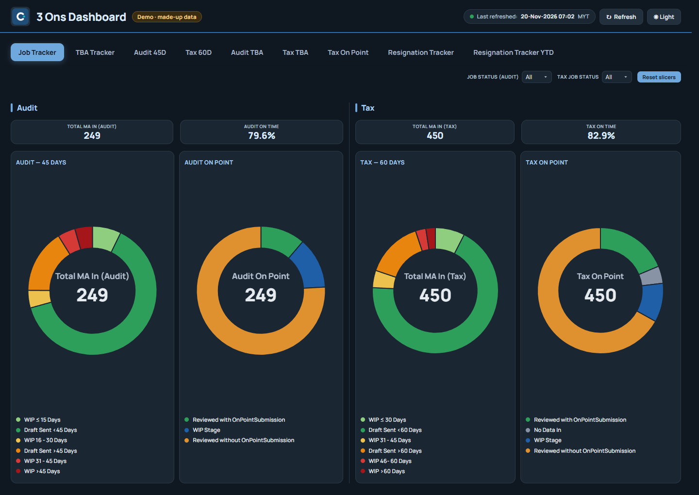</td>
<td width="30%" align="center"><b>On a phone</b>: the same dashboard, laid out for a small screen 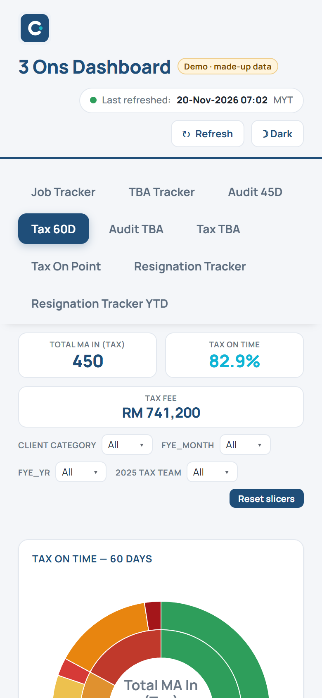</td>
</tr>
</table>

## Tech stack

All Microsoft, all inside the firm's own setup:

| Service | Its job here |
|---|---|
| **SharePoint and OneDrive** | where the teams keep their workbooks, and where the weekly frozen copy is saved |
| **Microsoft Graph** | reads the files, and can reach only the files IT granted; saves the weekly copy |
| **Azure Functions** (Python, pandas) | rebuilds the figures on request and every Saturday |
| **Azure Storage** | the locked store for the finished figures and the weekly copies |
| **Azure Static Web Apps** | delivers the dashboard to the browser (Free tier) |
| **Microsoft Entra ID** | the company login |
| **Application Insights** | keeps a log of every refresh and error |
| **Chart.js** | draws the charts in the browser |

## By the numbers

| | |
|---|---|
| Used by | the heads of Audit and Tax and their team managers |
| Tabs | 9, rebuilt from the old Power BI report |
| Sources read | 29, never changed: 27 workbooks and exports, 1 SharePoint list, 1 file from another dashboard |
| Refresh | on request (usually 60 to 90 seconds), and every Saturday before the weekly copy |
| Accuracy at go-live | job status 100% and tax on-time bands 100% against the old report; audit on-time bands 91.99%, every gap explained |
| Licences | no Power BI licences needed to view it |
| In use since | June 2026 |

## Made by

**trisglenanne9**
