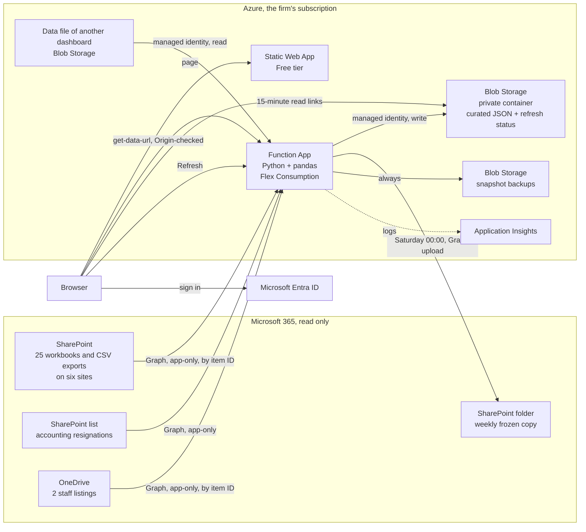

# Technical architecture

> All names, figures and screenshots in this repository are made up. The real system runs on a firm's own data and is private.
>
> This is the developer view. The plain-language overview is in the [README](../README.md).

## 1. The constraint that shapes it

**The source of truth stays where the teams keep it: 27 workbooks and exports in SharePoint and OneDrive, one SharePoint list, and one data file another dashboard already publishes.** Nobody re-keys anything, nothing writes back to those files, and before anyone trusts the new dashboard it has to reproduce the Power BI report it replaced. So the design is a read-only pipeline that rebuilds a handful of curated files from the sources on every refresh, and a front end that filters and counts those files in the browser.

Two rules came with the brief and decided a lot: **match the Power BI numbers first, then improve**, and **no hard-coded data**. The only constant in the engine is the cost rate per staff grade per year, decoded from the old `.pbix` itself.

The second constraint is cost: no Power BI licences, no always-on server, no database server.

The third is **where it may live: inside the firm's own Microsoft tenant.** The sources are already in SharePoint and staff already sign in with Microsoft accounts, so the engine, the data and the front end run on Microsoft 365 and the firm's Azure subscription, under the same sign-in. No outside service holds the data.

## 2. Where everything runs

| Box | Service | What it does |
|---|---|---|
| Source files | SharePoint and OneDrive (Microsoft 365) | Hold the workbooks and CSV exports. The teams update them; the dashboard only reads. |
| Accounting resignations | SharePoint list | Read through the Graph list API, written to a temporary CSV for the engine. |
| Data file of another dashboard | Azure Blob Storage | The quote register another dashboard already publishes; read for the value of work referred in by staff. |
| Function App | Azure Functions, Python 3.11, Flex Consumption | Downloads every source, runs the pandas engine, writes the curated files, mints read links, builds the weekly snapshot. Three HTTP endpoints and one timer. |
| Curated store | Azure Blob Storage, private container | Six curated JSON files and `refresh_status.json`. No public access. |
| Snapshot backups | Azure Blob Storage | A copy of every weekly frozen dashboard, kept whether or not the SharePoint upload worked. |
| Weekly copy | SharePoint folder | One self-contained HTML file per week, for the record. |
| Static Web App | Azure Static Web Apps, Free tier | The dashboard itself: one page with nine in-page tabs. All filtering and counting happens in the browser. |
| Sign-in | Microsoft Entra ID | Company accounts only, on every route. |
| Monitoring | Application Insights | Logs every refresh, snapshot run and error. |

The engine that runs in the Function is the same code that runs on a laptop. The Function only swaps the file-reading layer (Graph instead of a local folder) and points the output at a temporary directory, because the Flex Consumption deployment mount is read-only.

## 3. Data sources

| Source | Holds | Access | Refresh | Notes |
|---|---|---|---|---|
| Tax control workbooks (3, one per year) | one row per tax client per financial year: tax status, tax team, client category, year end, the date the management accounts came in, day counts to data-in, draft and submission, weekly comment; an On Point tab with quality-review submissions | Graph, by item ID | every refresh | stacked; de-duplicated on company + year end + service |
| Tax client index (1) | the sheet of resigned or closed tax clients: date, tax fee | Graph, by item ID | every refresh | joined to the client export for team and category |
| Audit job logs (6, one per audit team) | one row per audit job: detailed and rolled-up job status, audit stage, days from management accounts to draft, audit fee, client category, delay reason | Graph, by item ID | every refresh | macro-enabled workbooks with the header on row 2; two job types outside the report's scope are dropped |
| Audit resignation sheet (1) | this year's audit resignations: date logged, reason, fee, team, client category | Graph, by item ID | every refresh | reasons grouped into categories by a lookup carried over from the old report |
| Accounting resignations (SharePoint list) | client, services resigned, resignation date, approval status | Graph list API | every refresh | optional: the last saved copy is used if the list can't be read |
| Practice-management job reports (3, one per practising entity) | every job and its invoiced time amount | Graph, by item ID | automated CSV export | read as CSV directly |
| Practice-management time reports (6) | every timesheet line: staff, date, hours, task, billable amount | Graph, by item ID | automated CSV export | a current file and an older one per entity; together the bulk of the download |
| Practice-management client export (1) | each client's tax team and client category | Graph, by item ID | nightly export | contact-level, so one client appears on many rows |
| Client reports for audit and accounting (2) | client lists | Graph, by item ID | every refresh | fetched but not used by any current view |
| Tax quality-review form (1) | On Point submissions | Graph, by item ID | every refresh | fallback only: the On Point tab of the current tax control workbook is preferred because the form copy runs behind |
| Audit quality-review tracker (1) | On Point submissions per audit job | Graph, by item ID | every refresh | optional: if it can't be read, audit jobs read as "no submission" and the page says so |
| Staff listings (2, OneDrive) | each person's grade, year by year | Graph, by site + item ID | every refresh | optional: falls back to a saved snapshot, and the page says so |
| Cost-rate table | cost rate per grade per year | shipped with the engine | when rates change | the one constant, decoded from the old `.pbix` |
| Referred work | quote register rows: service, lead source, date signed back, value | managed identity with a read-only storage role | every refresh | as fresh as the other dashboard's own refresh |

**How the files are reached.** The engine reads with an app-only Graph identity that holds `Sites.Selected` and `Files.SelectedOperations.Selected`: IT granted it the specific sites and files it needs and nothing else. Under per-file grants a lookup by path has to walk from the library root, which the app cannot see, so it fails with 404 even when the path is right. Each file is therefore fetched **by its item ID first**, which touches only the granted file and survives a move or rename. A stored-path lookup, a sweep of the site's libraries and a filename search follow as fallbacks, and the route that worked is recorded for every file.

A required source that fails stops the refresh. The three optional ones degrade, and `meta.json` records which fallback was used, so the page can say so.

## 4. Pipeline

| Step | What happens | What it guarantees |
|---|---|---|
| Extract | Every source is downloaded into a temporary folder under the file name the engine expects. CSV exports are saved byte for byte; the reader checks the file's first bytes rather than its extension. After each file, the run writes its progress to `refresh_status.json`. | One consistent set of files per run. Every file's size, time and route (ID, path, sweep or search) is on record, so a moved file is noticed instead of silently drifting. |
| Clean | The old report's Power Query steps, ported one for one: blank company rows dropped; about twenty status codes mapped to four status groups; day counts put in bands; money parsed with thousands separators and bracketed negatives; timesheet durations read from `1:30` text as well as Excel times; one row per company, year end and service. | No value is lost to formatting, and every rule lives in one place in code instead of in page filters. |
| Combine | Invoiced time and timesheet cost attached to each job (where the practice-management system has two jobs for the same client, year and service, the one carrying the fee wins); cost = hours × the person's rate for their grade that year; margin and TBA category; On Point status from the submissions; resignations joined to the client export for team and category, preferring the row that actually states a team; referred work summed by service from the other dashboard's file. | The same inputs always give the same answer, whatever order the rows arrive in. |
| Store | Six curated JSON files (tax jobs, audit jobs, three resignation lists, and `meta.json` with the build time in Malaysia time, the as-of year, the referred-work totals and which fallbacks were used) written to a temporary folder, then uploaded to the private container. | The browser never gets an unreadable file: NaN and Infinity are refused at write time, and a table whose columns have all vanished stops the run instead of shipping empty. Nothing is uploaded unless the whole build succeeded, so a failed run leaves the last good figures in place. |

The curated files are **row-level**: one row per job or per resignation. The measures (Total MA In, On Time, the TBA counts, Fees to Cover) are computed in the browser from those rows, using the same filter logic as the old report's DAX. That is what lets every slicer and click filter respond instantly, with no server round trip.

A full download of every source comes to close to 200 MB, most of it timesheet CSV.

## 5. Data model & definitions

| File | One row per | Used by |
|---|---|---|
| tax jobs | tax client per financial year | Job Tracker, TBA Tracker, Tax 60D, Tax TBA, Tax On Point |
| audit jobs | audit job | Job Tracker, TBA Tracker, Audit 45D, Audit TBA |
| tax resignations | resigned tax client | both Resignation Trackers |
| audit resignations | resigned audit client | both Resignation Trackers |
| accounting resignations | item on the resignation list | both Resignation Trackers |
| `meta.json` | one object: build time, as-of year, referred work by service, fallbacks used | every tab, the Last refreshed stamp and the data-health warning |

The core definitions:

- **Status group**: every status code rolls up to *MA Not In* (management accounts not yet received), *WIP*, *Draft Sent* (draft sent, with the client, submitted or completed) or *Backlog / Resigned / Struck off*.
- **Total MA In**: jobs whose management accounts came in this year and that are WIP or Draft Sent.
- **Audit On Time** = 1 − (jobs with more than 45 days from management accounts to draft) ÷ jobs. **Tax On Time** is the same with 60 days.
- **TBA category**: margin = (invoiced − cost of time booked) ÷ invoiced. *Meet TBA* at 67% or more, *Not Meet TBA* below; *No Timesheet* when no time was booked; *No Invoice* when time was booked but nothing invoiced. Audit counts completed jobs; tax counts submitted returns.
- **On Point status**: *Reviewed with OnPointSubmission* when a quality-review submission exists this year; otherwise by how far the job has got.
- **Fees to cover** = fees of clients who resigned in the date range − the value of work referred in by staff this year.
- **Week**: Friday to Thursday.

Every metric, in one line each, is in the [user guide](GUIDE.md#4-definitions).

## 6. Refresh & monitoring

- **On demand**: the *Refresh* button calls `POST /api/refresh`. There is no cooldown: two refreshes in a row are fine. What is blocked is an **overlap**: if a run started less than 15 minutes ago and has not finished, a second call gets *"A refresh is already running"*, because two runs would write the same files and could leave a mix of both.
- **Weekly**: every Saturday at 00:00 Malaysia time a timer refreshes the sources first, then freezes the whole dashboard into **one self-contained HTML file**: the charting library inlined, the data inlined, no sign-in, no network calls, and the Refresh and Sign-out buttons removed. It is uploaded to a SharePoint folder by Graph, and a backup copy always goes to Blob Storage. If the refresh fails, the snapshot is still built from the data already in storage, and the file records whether its figures are from that week's close or older. A manual `POST /api/snapshot` runs the same code path.
- **Refresh status**: `refresh_status.json` is written after every file download, when the downloads finish, and at the end (done, or failed with the reason). The HTTP gateway gives up after about 230 seconds while the Function keeps running (its own limit is 30 minutes), so this file, not the HTTP response, is the reliable record of how far a run got.
- **Last refreshed**: the page shows when the engine last built the data, stamped in Malaysia time. If the page could not read the live data it says *Bundled snapshot* instead, so an old copy never passes for fresh figures.
- **Data health**: a warning chip appears, and only appears, when something is wrong: a source failed to load, a file was found only by search (moved or renamed), cost rates came from the saved snapshot, the audit quality-review tracker was missing, or the data is three or more days old. Adding `?health=1` to the address shows it even when all is clear.
- **Logs**: every refresh, snapshot and error goes to Application Insights.

There is deliberately no hourly timer: the data refreshes when someone asks, and at least once a week.

## 7. Hosting & access

- Every route of the Static Web App requires a Microsoft sign-in, except the signed-out page. Other identity providers return 404, and an unauthenticated request is redirected to Microsoft sign-in.
- After sign-in, the page checks two things: the account is not a personal Microsoft account, and its email domain is on the company's allow-list. Anyone else gets an *Access Restricted* page with a sign-out link.
- Sign-out runs in two stages, ending the app session and then the Microsoft session, so it does not quietly sign you back in.
- Everyone signed in sees every tab. There are no roles, because the page edits nothing.
- The page gets its data from `GET /api/get-data-url`. That endpoint is anonymous but checks the request's Origin against the dashboard's own address, and it returns read-only links to the curated files that expire after 15 minutes.
- The front end is deployed by a PowerShell script that needs no input: it derives the deployment token from the developer's signed-in Azure session. The Function is published with a remote build.

## 8. Security & privacy

- **No storage key or connection string ever reaches the browser.** The curated container is private. Read links are **user-delegation SAS**, signed with the Function's managed identity rather than an account key, read-only, one per file, valid for 15 minutes.
- **Read-only on the sources.** The Graph identity can see only the sites and files IT granted, and it reads them. The only write access is to the one library the weekly copy is saved to.
- **Two identities, kept apart.** The Graph app registration is used only for SharePoint and OneDrive; the managed identity is used only for storage. Both are named explicitly in code. (Letting the Azure SDK pick a credential by itself made every storage call sign in as the Graph app, which holds no storage role: a real bug from bring-up.)
- **Secrets stay out of the repository.** The Graph client secret lives in the Function App's settings, and anything a deploy needs is written into git-ignored config at deploy time.
- **The weekly copy carries nothing live**: no key, no API address, no sign-in, just the page and that week's figures.
- **This showcase** contains no code and no real data. The demo runs on generated data for a fictional firm, Contoso Advisory Group.

## 9. How accuracy is checked

1. **Read the old report before writing any code.** Its Power Query steps, every DAX measure, and every page filter, visual filter and saved slicer selection were extracted from the `.pbix` into a measure contract and a visual spec. Two traps turned up there: aggregation names in the report definition are stale aliases (the stored function code is the truth), and a tile's real filter is page + visual + saved slicer + the measure's own `CALCULATE`, not the page filter alone.
2. **Test the logic on identical inputs.** A `.pbix` carries its own cached data. A reconciliation script feeds the old report's cached raw columns through the engine's rules and compares the result with the report's cached derived columns. It exits non-zero below the threshold, so it works as a gate:

   | Check | Result | Pass mark |
   |---|---|---|
   | Tax status group | 100.00% | 100% |
   | Tax on-time status | 100.00% | 100% |
   | Audit status group | 100.00% | 100% |
   | Audit on-time status | 91.99% | 90% |

3. **Why 91.99% is right.** Every remaining difference is a job one day either side of an audit band boundary. In the source workbook, the band column was frozen at an earlier date while its day-count formula kept counting, so the two disagree inside the source itself. The Audit On Time percentage counts days over 45 directly rather than reading the band, so it is exact for any given data.
4. **Why totals are not compared directly.** The `.pbix` data is a snapshot from the day it was last refreshed, while the workbooks have kept moving. Absolute totals drift for good reasons, so the logic is proved on identical inputs instead.
5. **Cross-dashboard check.** The referred-work totals by service are identical whether read from the local quote workbook or from the other dashboard's live data file.
6. **Front-end harnesses.** Node scripts run the page against a stubbed DOM: they render every tab and report errors and headline figures, apply a cross-filter and confirm every measure recomputes and every chart rebuilds with data, and check that charts update in place rather than being redrawn. The weekly snapshot template is regenerated from the live page by a script that asserts every patch it makes and parses every inline script with Node before it accepts the result.
7. **What the reconciliation found**, in the old report and in early versions of the new engine:
   - the two "resign and refer" cards are scoped to the year by a saved date slicer and to one service by a visual filter; an early version summed every year and every service, and came out far from the report;
   - money arriving as `1,234.56` text from the CSV exports became blank, silently dropping every value of 1,000 or more;
   - timesheet durations arriving as `1:30` text were charged as a full day each, inflating cost several-fold;
   - where the practice-management system held two jobs for the same client and year, an empty duplicate was picked over the one carrying the fee;
   - the standalone quality-review form ran two months behind the copy in the tax control workbook, turning the Tax On Point ring upside down;
   - the client export lists a client on many rows, and taking the first one left some resigned clients with no team;
   - dates from the SharePoint list arrived in UTC and showed as the day before;
   - a zero invoice produced `-Infinity`, which made the browser reject the whole file;
   - the build time was stamped in UTC and shown as if it were Malaysian time.

## 10. Design decisions

| Decision | Why | Rejected |
|---|---|---|
| One pandas engine, run locally and in the Function | reconciliation is a fast local loop; the deployed code is the code that was reconciled | building online first and reconciling live, which cost days on an earlier dashboard |
| Row-level facts, measures computed in the browser | every slicer and click filter is instant; the measures mirror the old DAX one for one | pre-aggregated files per chart (every filter change would need the server); a SQL database and API |
| Fetch every file by item ID first | under per-file grants a path lookup 404s even when the path is right; an item ID survives moves and renames | path-only lookups; asking for tenant-wide `Files.Read.All` |
| Read referred work from the other dashboard's data file | one definition shared by two dashboards, and no new SharePoint grant | a second copy of the quote workbook |
| Private storage + 15-minute read links | the data names clients and their fees | one public JSON file |
| Static Web Apps, Free tier, Microsoft sign-in, domain allow-list | company sign-in at no cost | Standard tier with a dedicated Entra app |
| One page with nine in-page tabs | the weekly snapshot is simply the page with its data inlined | a shell with iframed tab pages, which made an earlier dashboard's snapshot need a full rewrite |
| Refresh on request + weekly, no hourly timer | the teams update their files all day; the weekly run freezes the week as it closed | an hourly timer |
| A status file written during the run | the gateway drops the response after about 230 seconds | relying on the HTTP response |
| Managed identity named explicitly for storage | the Graph settings hijacked the SDK's default credential chain | `DefaultAzureCredential` |
| Everything on Microsoft 365 and Azure | same sign-in, same tenant, data never leaves it, nothing new for IT to vet | third-party BI tools; staying on Power BI with a licence per viewer |

## 11. Known limits

- **Year-bound sources.** The tax control workbooks are one per year, and each new year's workbook has to be added to the source map. The "this year" views follow the calendar year of the build date, so they move on 1 January.
- **The cost-rate table is a constant.** A new grade or a new year's rates means updating it. If the staff listings can't be read, cost comes from a saved snapshot, and the page says so.
- **Item IDs can go stale.** A file that is deleted and uploaded again gets a new ID. The fallbacks only help where the app can see the library, so on some sites the stored ID has to be updated.
- **Referred work does not follow the date pickers.** It is the other dashboard's figure for the year to date, so Fees to Cover is only meaningful on the YTD tab.
- **Some tax resignations have no exact date.** They are counted only when the chosen range covers their whole year.
- **Long refreshes look like failures.** A run that outlasts the gateway's 230 seconds returns an error to the button while it carries on; reloading a few minutes later shows the result.
- **Scope follows the old report.** Audit covers the six audit teams in that report; its landing page, a top-client listing, a staff leaderboard and an accounting review page were not rebuilt.
- **The snapshot template is generated from the live page.** A front-end change can break the generator, which fails loudly rather than producing a wrong archive.
