# User guide

> All names, figures and screenshots in this repository are made up. The demo uses a fictional firm, Contoso Advisory Group, with fictional clients and teams.

## 1. Who uses it and for what

The heads of Audit and Tax and their team managers use it to:

- see how many audit and tax jobs are in this year, and what share is on time: audit drafts within **45 days** of the management accounts coming in, tax drafts within **60 days**;
- find the late jobs, by team, job status and client category, down to the company;
- check that finished work paid for itself: whether the fee covered the cost of the time booked (**TBA**);
- check that reviewed work went through the **On Point** quality-review form;
- follow which clients are leaving audit, tax and accounting services, week by week and year to date, and how much fee has to be won back.

## 2. The routine

| When | What |
|---|---|
| Every working day | The teams update their tax control workbooks and audit job logs as jobs move: status, dates, the weekly comment. Anyone can press **Refresh** to pull the latest in (usually 60 to 90 seconds). |
| Overnight | The practice-management system's client export is renewed in SharePoint, and its job and timesheet exports are updated automatically too. The next refresh picks them up. |
| Every week, at the review of open jobs with each team manager | Start on the Job Tracker; go to Audit 45D and Tax 60D for the late jobs, the TBA tabs for the jobs that missed, then the Resignation Trackers. |
| Every Friday | A new week starts. The Resignation Tracker opens on the week that ended the day before (Friday to Thursday). |
| Every Saturday 00:00 | The dashboard refreshes itself, and a frozen copy of the whole thing is saved to SharePoint for the record. |
| 1 January | The "this year" views move on to the new year, and the Resignation Tracker YTD starts again from 1 January. |

## 3. The views

### Controls on every tab

- **Tabs** run across the top: Job Tracker, TBA Tracker, Audit 45D, Tax 60D, Audit TBA, Tax TBA, Tax On Point, Resignation Tracker, Resignation Tracker YTD.
- **Slicers** are tick-box lists. *All* means everything is ticked. *Select all / Deselect all* sits at the bottom of each list, and *Reset slicers* clears the whole tab. *Deselect all* empties the page until you tick something, as Power BI does.
  - Each list only offers values found in the tab's own scope, so a pick rarely leaves a chart empty.
  - **Client Category** offers the five real categories, plus a **Private + Premier Private** shortcut that ticks both at once. Rows with a mistyped category still count in every total; they just aren't offered as a filter.

  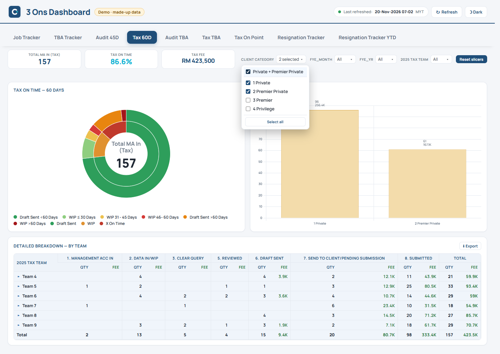

- **Click to filter.** Click a ring slice, a bar or a company row, and every card, chart and table on the tab follows. The chosen slice stays bright and the rest fade, so you keep the proportion in view. A **Cross-filter** chip names what is applied: its **✕** removes it, *Clear all* removes every one, and clicking the same slice again also removes it.

  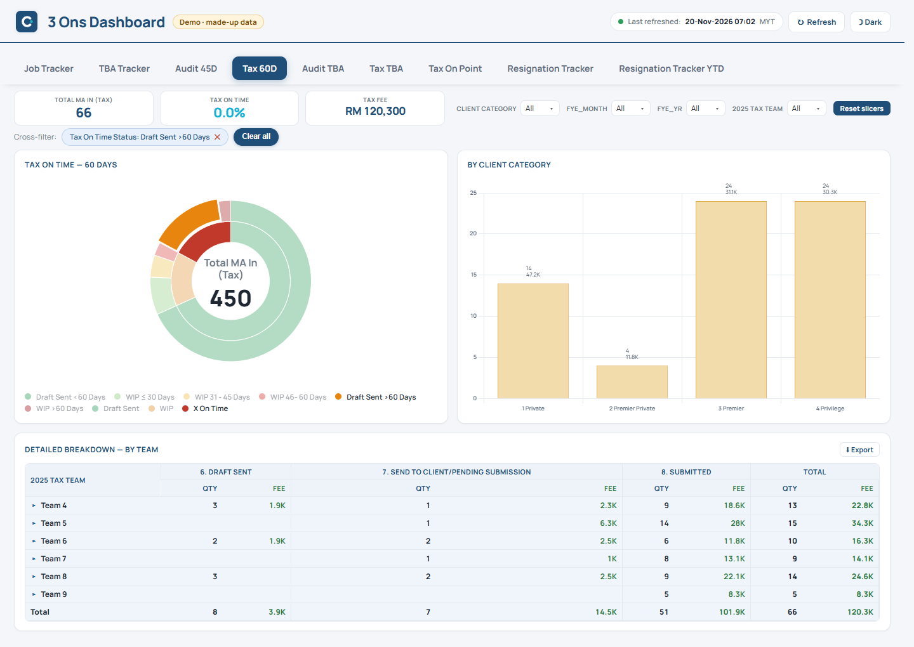

- **Drill-down tables.** Click a team (▸) to open the companies behind it, and again (▾) to close it. Clicking a company filters the tab to it.

  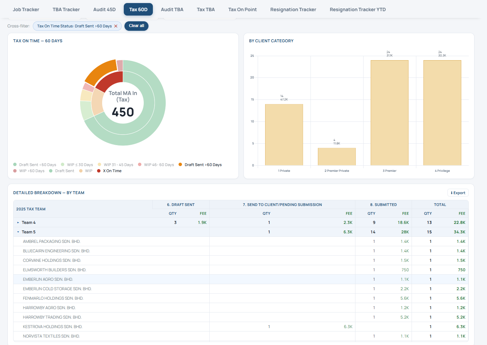

- **Hover** a ring slice to see its name, its share and its count.
- **Export** (on Tax 60D, Tax TBA and Resignation Tracker YTD) downloads a CSV of exactly the rows behind the table on screen, after slicers and clicks, ready for Excel.
- **Last refreshed** (top right) shows when the figures were last rebuilt, in Malaysia time. **Refresh** rebuilds them from the source files.
- **Data health**: a warning strip appears under the header only when something is wrong. See [section 6](#6-when-something-looks-wrong).
- **Dark mode**: the moon / sun button. Your choice is remembered in your browser; on a first visit it follows your device.

  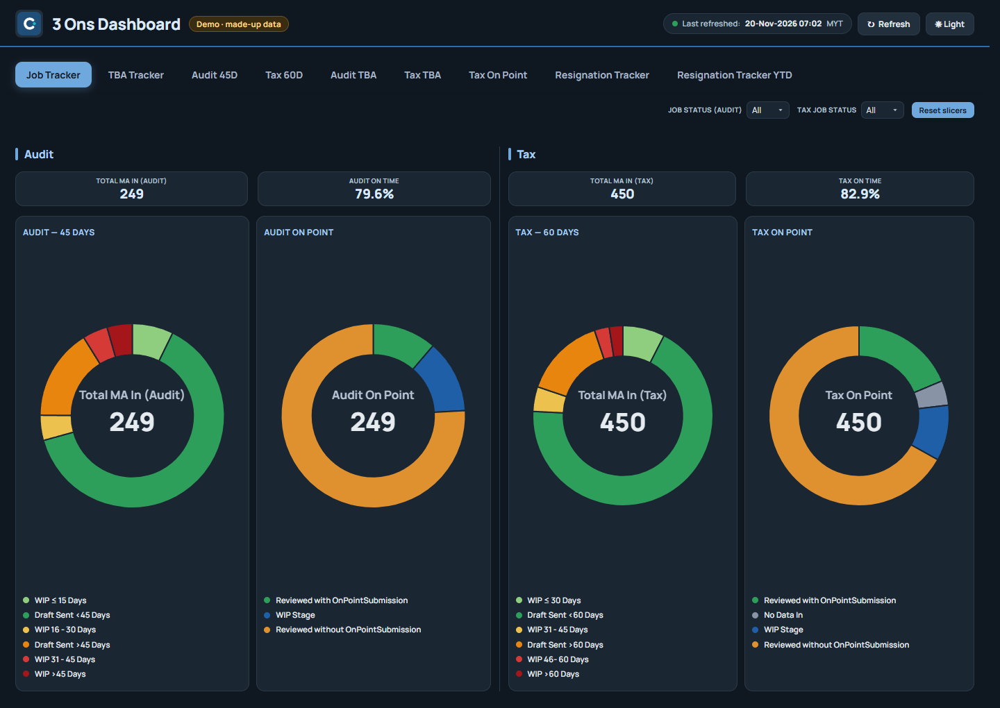

- **On a phone** the same dashboard is laid out for a small screen.

### Job Tracker

*How many jobs are in this year, how many are on time, and did reviewed work go through On Point?*

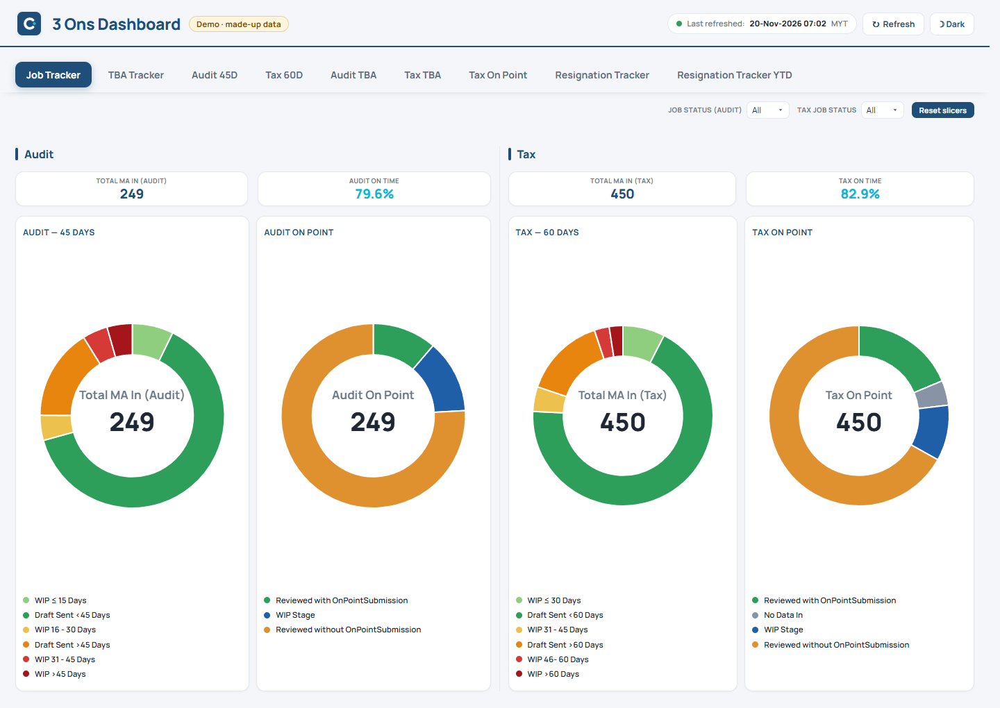

- **Two columns**, Audit on the left and Tax on the right.
- **Cards**: *Total MA In* (jobs whose management accounts came in this year and are in progress or sent) and *On Time* (the share within 45 days for audit, 60 for tax).
- **Audit — 45 Days / Tax — 60 Days**: each ring splits the jobs into time bands. Dark green is sent on time; light green, yellow and red are in progress with less and less time left; orange is sent late; deep red is in progress and already late. The total is in the middle.
- **Audit On Point / Tax On Point**: how many jobs have their quality-review form, how many are past review without one, and how many haven't reached review yet.
- **Filters**: *Job Status (Audit)*, the detailed audit status, applies to the audit side only. *Tax Job Status* (WIP or Draft Sent) applies to the tax side only. Each list only offers values that still exist given the other.
- **Note**: a click on a tax chart greys out the audit charts, and the other way round, because one side's choice can't filter the other side's jobs.

### TBA Tracker

*Of the work that is finished, how much covered the cost of its time?*

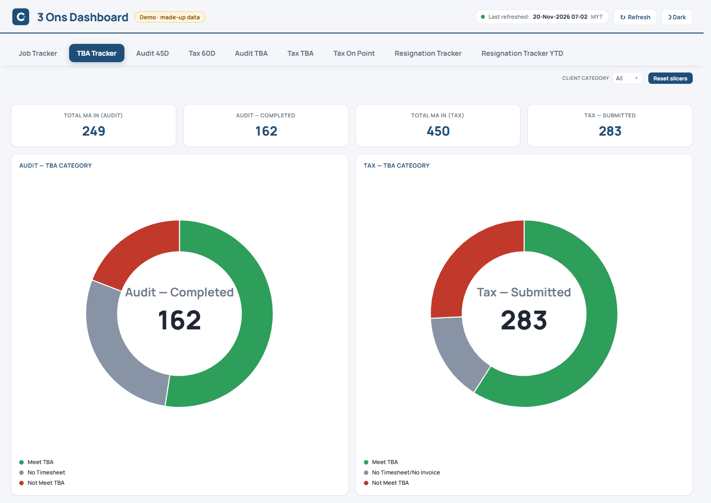

- **Cards**: *Total MA In* for audit and for tax, beside *Audit — Completed* and *Tax — Submitted*, the finished jobs the rings judge.
- **Audit — TBA Category / Tax — TBA Category**: rings of *Meet TBA* (green), *Not Meet TBA* (red), *No Timesheet* (grey) and, where it occurs, *No Invoice* (orange). The number of finished jobs is in the middle.
- **Filter**: *Client Category*, which drives both rings at once.

### Audit 45D

*Which audit jobs are past 45 days, and where are they?*

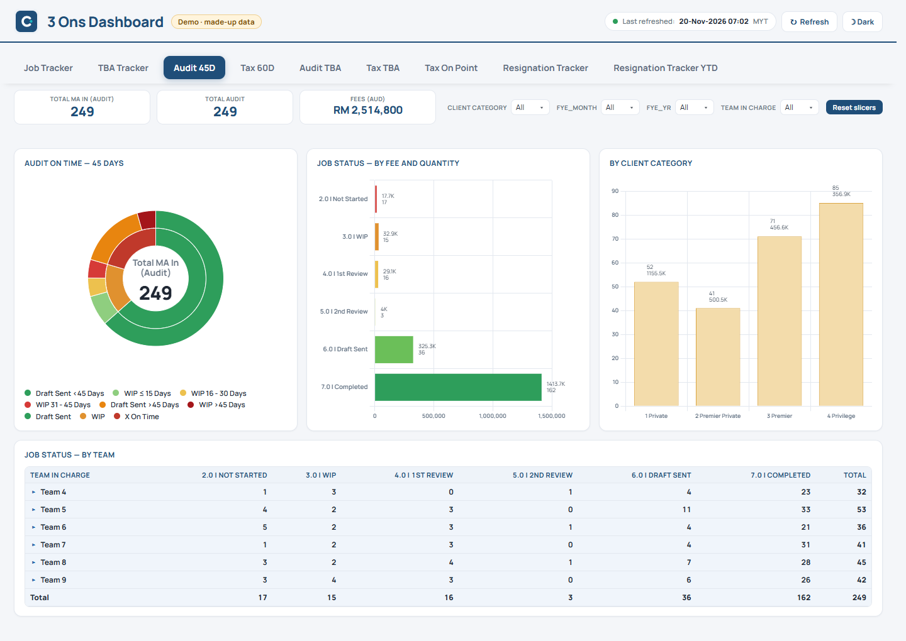

- **Cards**: *Total MA In (Audit)*, *Total Audit* (this year's whole live portfolio, including jobs still waiting for accounts) and *Fees (Aud)*.
- **Audit On Time — 45 Days**: a two-level ring. The inner ring is the on-time group (sent on time, late, still in progress); the outer ring breaks each group into its time bands. Click either ring to filter.
- **Job Status — By Fee and Quantity**: one bar per job status, from *Doc Not Ready* to *Completed*, coloured red to green along the pipeline. Bar length is the fee invoiced; the labels give the fee and the number of jobs.
- **By Client Category**: one column per category. Height is the number of jobs; the labels give the count and the audit fee.
- **Job Status — By Team**: teams down the side, job status across the top, counts in the cells. Open a team to see its companies.
- **Filters**: *Client Category*, *FYE_Month* and *FYE_Yr* (the client's financial year end), *Team In Charge*.

### Tax 60D

*Which tax jobs are past 60 days, what do they bill, and which team holds them?*

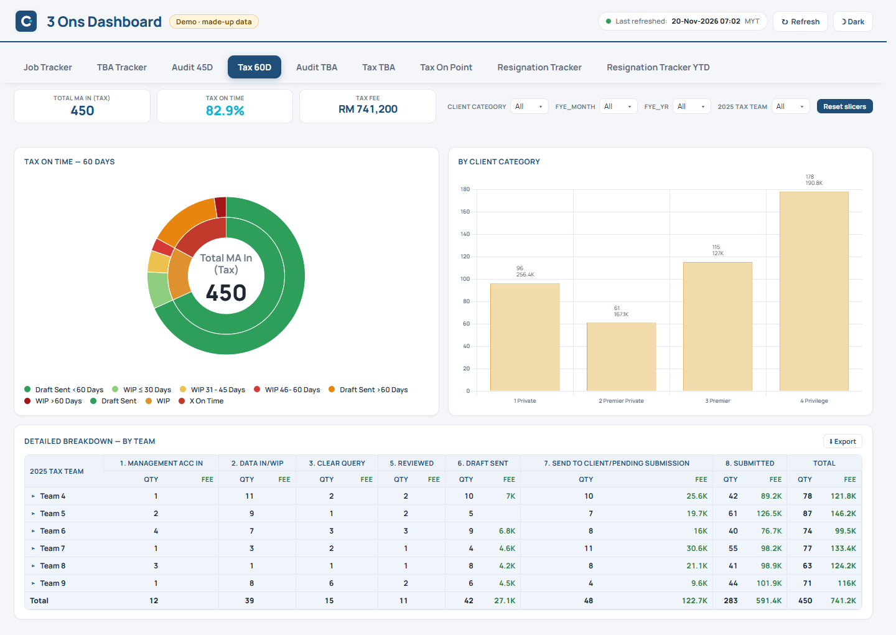

- **Cards**: *Total MA In (Tax)*, *Tax On Time* and *Tax Fee*.
- **Tax On Time — 60 Days**: the same two-level ring as Audit 45D, with 60-day bands.
- **By Client Category**: jobs per category, labelled with the count and the fee invoiced.
- **Detailed breakdown — By Team**: teams down the side, each tax status across the top with a *Qty* and *Fee* pair, then totals. Open a team to see its companies.
- **Export**: one row per company per status, with its count, its fee and its **weekly comment**, which the table has no room to show.
- **Filters**: *Client Category*, *FYE_Month*, *FYE_Yr* and the tax team (labelled *2025 TAX TEAM*). The team list opens with every team ticked except one the old report left out and jobs with no team; tick them back on to include them.

### Audit TBA

*Which completed audit jobs did not pay for their time, and why?*

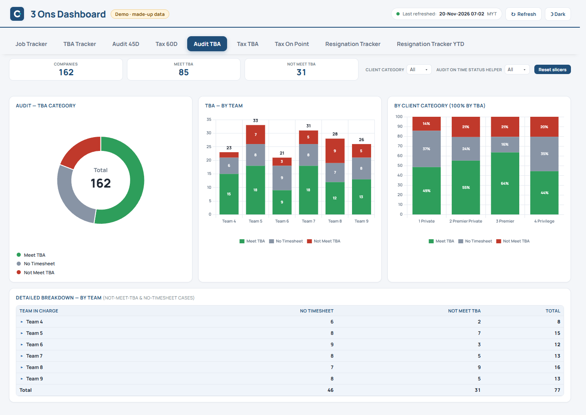

- **Cards**: *Companies* (completed jobs in view), *Meet TBA*, *Not Meet TBA*.
- **Audit — TBA Category**: the ring of categories.
- **TBA — By Team**: one stacked bar per team, split by category. Click a team to filter.
- **By Client Category (100% by TBA)**: each category's mix, every bar at full height so the shares compare.
- **Detailed Breakdown — By Team**: only the problem cases (*Not Meet TBA* and *No Timesheet*), team then company.
- **Filters**: *Client Category* and the on-time group (labelled *Audit On Time Status Helper*), to see whether late jobs are also the ones that miss.

### Tax TBA

*The same question for submitted tax returns.*

- The same layout as Audit TBA, with the tax team in place of the audit team. A job with no time booked reads *No Timesheet/No Invoice*.
- **Export**: the problem cases with team, company, **weekly comment** and category.
- **Filters**: *Client Category* and the on-time group (labelled *Tax On Time Status Helper*).

### Tax On Point

*How many tax jobs past review have their quality-review form?*

- **One ring** of On Point status, with *Total MA In (Tax)* in the middle. Click a slice to highlight it.
- It covers the same jobs as the Tax column of the Job Tracker, so the two agree.
- No filters, as on the old report's page.

### Resignation Tracker

*Who left us in the week that just closed?*

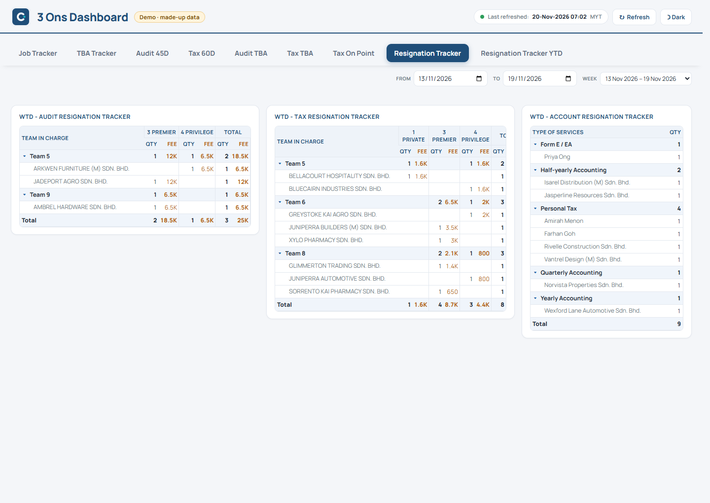

- **Dates**: *From* and *To* can be set to any range up to today. *Week* is a shortcut that fills both with a Friday-to-Thursday week; typing a date afterwards switches it to *Custom range*. It opens on the latest closed week.
- **Three lists side by side**:
  - *Audit Resignation Tracker*: teams, opening to companies, with a *Qty* and *Fee* pair per client category.
  - *Tax Resignation Tracker*: the same for the six tax teams it tracks.
  - *Account Resignation Tracker*: one row per type of service resigned, opening to the clients, with a count.
- On this tab the lists open already expanded, because they are read name by name. Click a company to filter its list.

### Resignation Tracker YTD

*Who has left this year, and how much fee is still to be covered?*

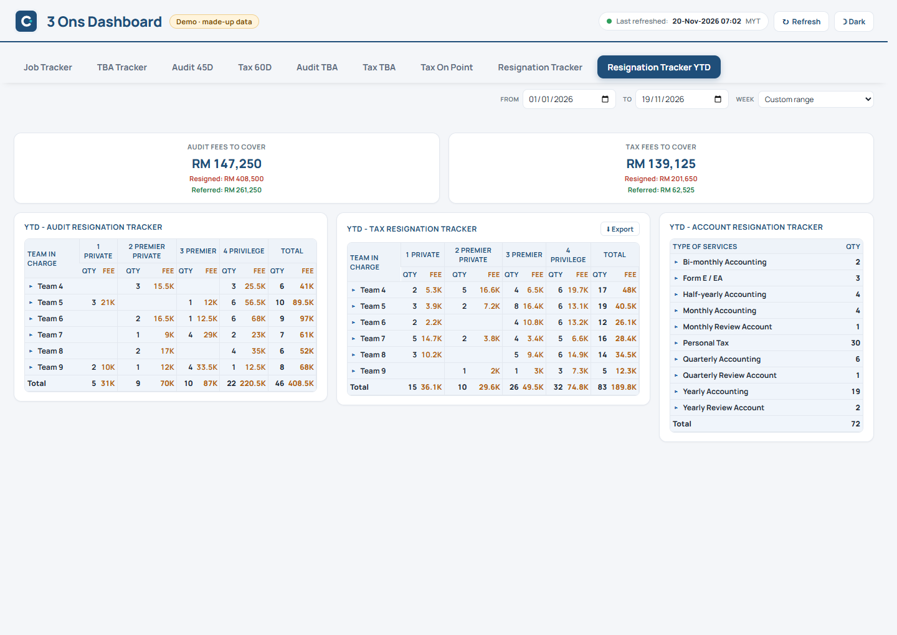

- **Dates**: the same controls, opening on 1 January to the latest closed week.
- **Audit Fees to Cover / Tax Fees to Cover**: fees lost to resignations in the range (*Resigned*, red) less the value of work referred in by staff this year (*Referred*, green).
- **The same three lists**, collapsed so the totals show first. The account list leaves out requests that were rejected, as the old report's YTD page did.
- **Export** on the tax list: one row per company, with team, reason, client category, count and fee.

## 4. Definitions

| Metric | Definition |
|---|---|
| Management accounts in (MA In) | The date the client's management accounts were received. Every on-time clock starts here. |
| Status group | Every job status rolls up to *MA Not In* (accounts not yet received), *WIP* (received, being worked or reviewed), *Draft Sent* (draft sent, with the client, submitted or completed) or *Backlog / Resigned / Struck off*. |
| Total MA In (Audit) | Audit jobs whose management accounts came in this year and that are WIP or Draft Sent. |
| Total MA In (Tax) | The same for tax. On the Job Tracker, TBA Tracker and Tax On Point it leaves out one team the old report left out. |
| Days to draft | Days from the management accounts coming in to the draft going out, as counted in the team's own workbook. |
| Audit On Time | 1 − (audit jobs with more than 45 days to draft ÷ audit jobs in view). On the Job Tracker it covers every year's WIP and Draft Sent jobs, as the old report's card did. |
| Tax On Time | 1 − (tax jobs with more than 60 days to draft ÷ tax jobs in view). |
| Audit time bands | WIP ≤ 15, 16–30, 31–45 and > 45 days; Draft Sent < 45 days (on time, 45 included) and > 45 days (late). |
| Tax time bands | WIP ≤ 30, 31–45, 46–60 and > 60 days; Draft Sent < 60 days (on time, 60 included) and > 60 days (late). |
| On-time group | The inner ring and the *On Time Status Helper* slicers: *Draft Sent* = sent on time, *X On Time* = late whether sent or not, *WIP* = in progress and still within the deadline. |
| Total Audit | This year's audit jobs that are MA Not In, WIP or Draft Sent: the live portfolio, including jobs still waiting for accounts. |
| Fees (Aud) | The audit fee recorded in the team job logs, for this year's jobs. |
| Tax Fee | The amount invoiced in the practice-management system, for this year's tax jobs. |
| Invoiced | A job's invoiced time amount in the practice-management system. Where there are two jobs for the same client, year and service, the one carrying the fee is used. |
| Cost of time | Hours booked to the job × the person's cost rate for their grade that year. Two non-billable task types are left out. |
| Margin | (Invoiced − cost of time) ÷ invoiced. |
| Meet TBA | A margin of 67% or more. |
| Not Meet TBA | A margin below 67%. |
| No Timesheet | No time was booked to the job. Tax calls it *No Timesheet/No Invoice*. |
| No Invoice | Time was booked, but nothing was invoiced. |
| Audit — Completed | This year's audit jobs with the status *Completed*: the jobs the TBA views judge. |
| Tax — Submitted | This year's tax jobs whose return has been submitted: the jobs the TBA views judge. |
| Companies (TBA tabs) | The finished jobs in view, after slicers and clicks. |
| On Point | The firm's quality-review form, filed when a job is reviewed. |
| Reviewed with OnPointSubmission | The job has an On Point submission this year. |
| Reviewed without OnPointSubmission | The job is past review but has no submission. |
| WIP Stage / Not Started Stage / No Data In | Not at review yet: in progress; not started (audit); accounts not in or only just in (tax). |
| Client category | Private, Premier Private, Premier or Privilege. |
| Week | Friday to Thursday. The latest closed week ends on the most recent Thursday. |
| Resigned | The fees of clients who resigned in the chosen dates: the audit fee for audit, the tax fee for tax. |
| Referred | The value of new work referred in by staff and signed this year, by service, leaving out tax advisory. It comes from another of the firm's dashboards and is a year-to-date figure. |
| Fees to cover | Resigned − Referred. |
| Last refreshed | When the engine last rebuilt the figures, in Malaysia time. It is not the age of the source files. |

## 5. "Why does this number differ from …?"

| You see | Why | What to do |
|---|---|---|
| A different figure from the old Power BI report | Power BI showed the data as at its last refresh; this reads today's files | Compare on the same day's files. The rules matched on identical data before go-live. |
| Audit 45D shows more jobs than the old report did when opened | The old report's audit pages opened with only Private and Premier Private picked; here every category is in until you pick | Tick **Private + Premier Private** in Client Category. |
| Audit On Time on the Job Tracker doesn't move with Total MA In | It covers every year's WIP and Draft Sent audit jobs, as the old card did; Total MA In counts this year only | Nothing to fix. |
| Total MA In (Tax) is different on the Job Tracker and on Tax 60D | Tax 60D leaves out jobs with no tax team by default; the Job Tracker keeps them, as the old report did | Tick *(blank)* in the tax team list to compare. |
| TBA counts are much smaller than Total MA In | TBA judges finished work only: completed audit jobs and submitted tax returns | Read them as "of the finished jobs". |
| The two fee figures on Audit 45D disagree | *By Fee and Quantity* uses the amount invoiced in the practice-management system; *By Client Category* and *Fees (Aud)* use the audit fee in the job logs, as in the old report | Nothing to fix. |
| A job's fee differs from one job in the practice-management system | Where the system holds two jobs for the same client, year and service, the one carrying the fee is used | Look at the other job. |
| The Tax Resignation list total is lower than *Resigned* on Tax Fees to Cover | The list shows the six teams it tracks; the card covers every team | Nothing to fix. |
| Fees to Cover hardly moves when you narrow the dates | *Resigned* follows the dates; *Referred* is fixed year to date | Read Fees to Cover with the year-to-date range. |
| The Tax On Point ring adds up to less than the number in its middle | The middle counts every job in view; the ring leaves out jobs with no On Point status | Nothing to fix. |
| Audit On Point shows every job without a submission | The quality-review tracker could not be read; the data-health strip says so | Ask its owner whether it was moved, then Refresh. |

## 6. When something looks wrong

| Symptom | Likely cause | What to do |
|---|---|---|
| Numbers unchanged after a new release | A release ships code, not data | Press **Refresh**. |
| *Last refreshed* is today but a figure looks stale | The refresh ran, but the source workbook had not been updated | Ask the team that keeps that workbook. |
| A fix you were told about isn't there | Your browser kept the old page | Hard reload: Ctrl + Shift + R. |
| Data health: *sources failed to load* | A file was locked, deleted, or its access was removed | Refresh again later. If it stays, tell the developer which file it names. |
| Data health: *found by search — moved or renamed* | Someone moved or renamed the file; the figures are still right | Tell the developer, so the stored location can be updated. |
| Data health: *Base Cost / TBA cost came from a cached snapshot* | The staff listings couldn't be read, so cost uses the last saved grades | Tell the developer; the TBA figures may lag new staff or promotions. |
| Data health: *Data is N days old* | Nobody has pressed Refresh for three days or more | Press **Refresh**. |
| The header says *Bundled snapshot* instead of *Last refreshed* | The page could not read the live data | Reload. If it stays, sign out and back in. |
| *A refresh is already running* | Someone started one less than 15 minutes ago | Wait a minute, then reload. |
| Refresh reports an error after about four minutes | The web gateway stopped waiting; the refresh carries on behind it | Reload in a few minutes and check *Last refreshed*. |
| Refresh says the site has no key configured | The deployment is missing its Refresh key | Tell the developer. |
| A tab is empty and a slicer reads *None* | *Deselect all* was pressed | *Select all*, or *Reset slicers*. |
| Half of the Job Tracker is grey | A click filter is on the other side | Press ✕ on the chip, or *Clear all*. |
| The Resignation Tracker shows nothing | Nothing was logged in that week | Widen *From* and *To*. |
| *Access Restricted* after signing in | A personal Microsoft account, or an email outside the company's domains | Sign out and use your company account. |
